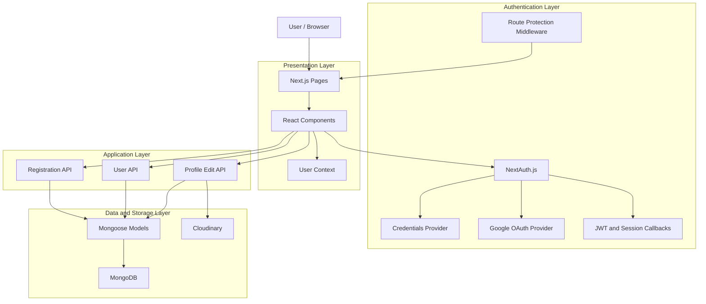
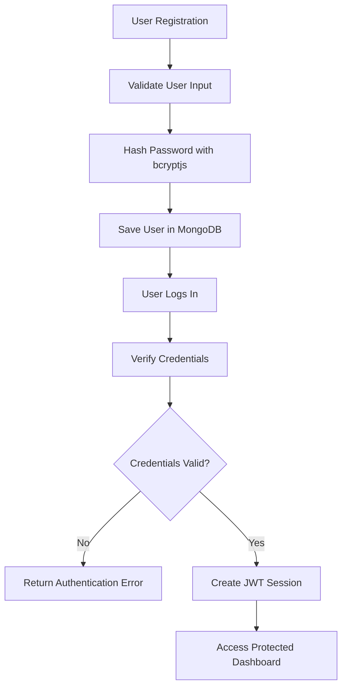
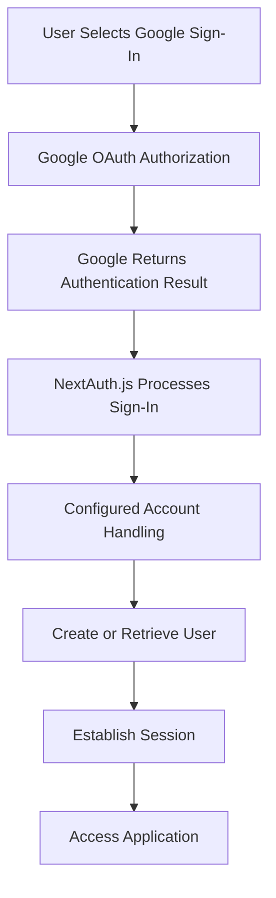
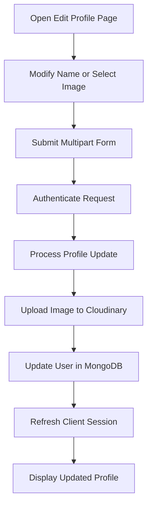

# 👤 Next.js Profile Manager & Authentication System

A full-stack **user authentication and profile management application** built using Next.js, NextAuth.js, MongoDB, Mongoose, and Cloudinary. The application supports secure email-password authentication, Google OAuth, protected routes, and profile customization with image uploads.

The project demonstrates a complete authentication workflow with database integration, session management, server-side API routes, and cloud-based media storage.

---

## 📌 Table of Contents

- [Overview](#-overview)
- [Features](#-features)
- [Tech Stack](#-tech-stack)
- [System Architecture](#-system-architecture)
- [Authentication Flow](#-authentication-flow)
- [Project Structure](#-project-structure)
- [Getting Started](#-getting-started)
- [Environment Variables](#-environment-variables)
- [API Reference](#-api-reference)
- [Security Considerations](#-security-considerations)
- [Running the Application](#-running-the-application)
- [Deployment](#-deployment)
- [Future Improvements](#-future-improvements)

---

## 📖 Overview

The **Next.js Profile Manager & Authentication System** provides users with a centralized platform to register, log in, and manage their personal profile information.

It integrates multiple technologies to handle authentication, user data persistence, image storage, and session synchronization.

### Core Capabilities

- User registration and login using email and password.
- Google authentication through OAuth 2.0.
- Secure password hashing using `bcryptjs`.
- Protected dashboard and authenticated API endpoints.
- Profile editing, including name and profile picture updates.
- Cloudinary integration for profile image storage.
- JWT-based session handling through NextAuth.js.
- MongoDB connection caching for efficient database access.

---

## ✨ Features

### 🔐 1. Authentication System

- **Credentials Authentication:** Register and log in using email and password.
- **Google OAuth:** Authenticate using a Google account.
- **Password Hashing:** Store password hashes instead of plaintext passwords.
- **JWT Sessions:** Maintain authentication state using NextAuth.js.
- **Account Creation:** Support user creation for configured authentication providers.

### 🛡️ 2. Protected Routes

- Middleware-based access control.
- Authenticated access to the dashboard.
- Redirection of unauthorized users to the appropriate authentication page.
- Authentication checks for protected API endpoints.

### 👤 3. Profile Management

- View profile information and avatar.
- Update the user's display name.
- Upload a new profile picture.
- Persist profile changes in MongoDB.
- Synchronize updated profile information with the client session.

### 🖼️ 4. Cloudinary Image Upload

- Cloud-based image storage.
- Server-side upload processing.
- Stream-based image upload support.
- Store and retrieve the resulting image URL for profile display.

### ⚡ 5. Session Synchronization

- Client-side session access using `useSession()`.
- Session refresh using `useSession().update()`.
- NextAuth JWT callback handling for supported session updates.
- Synchronization between the displayed profile and persisted user information.

### 🗄️ 6. Database Optimization

- MongoDB integration through Mongoose.
- Reusable database connection helper.
- Cached connections to reduce unnecessary reconnections in serverless environments.

### 🎨 7. User Interface

- Responsive dark-themed interface.
- Tailwind CSS styling.
- React Icons for interface elements.
- Dedicated login, registration, dashboard, and profile editing pages.

---

## 🛠️ Tech Stack

| Layer | Technology | Purpose |
|---|---|---|
| Framework | Next.js 16 | Full-stack application and routing |
| Frontend | React 19 | Component-based UI |
| Language | TypeScript | Type safety |
| Styling | Tailwind CSS v4 | Responsive styling |
| Authentication | NextAuth.js v4 | Credentials and Google OAuth |
| Database | MongoDB | Persistent user data |
| ODM | Mongoose | Database schemas and queries |
| Password Security | bcryptjs | Password hashing and verification |
| Image Storage | Cloudinary | Profile image storage |
| HTTP Client | Axios | API requests |
| Icons | React Icons | UI iconography |
| Deployment | Vercel | Application hosting |

---

## 🏗️ System Architecture

The application follows a layered architecture in which the frontend communicates with backend API routes, authentication services, the database, and external media storage.



### Architecture Explanation

1. **Presentation Layer:** Next.js pages and React components provide the user interface for registration, login, dashboard access, and profile editing.
2. **Authentication Layer:** NextAuth.js handles the configured authentication providers, JWT callbacks, and session management.
3. **Application Layer:** API routes process registration, authenticated user retrieval, and profile updates.
4. **Data Layer:** Mongoose manages the user schema and communicates with MongoDB.
5. **Media Storage Layer:** Cloudinary stores profile images and provides image URLs for the application.

**Important:** The diagram represents the intended logical architecture. Actual request paths and authorization checks depend on their implementation in the source code.

---

## 🔄 Authentication Flow

### Email and Password Authentication



### Google OAuth Authentication



Google account creation and database synchronization depend on the configured NextAuth provider and callbacks.

### Profile Update Flow



---

## 📁 Project Structure

```text
practiceproject2/
│
├── app/
│   ├── api/
│   │   ├── auth/
│   │   │   ├── [...nextauth]/
│   │   │   │   └── route.ts       # NextAuth authentication handler
│   │   │   └── register/
│   │   │       └── route.ts       # User registration endpoint
│   │   │
│   │   ├── edit/
│   │   │   └── route.ts           # Profile update and image upload
│   │   │
│   │   └── user/
│   │       └── route.ts           # Authenticated user retrieval
│   │
│   ├── edit/
│   │   └── page.tsx               # Profile editing page
│   │
│   ├── login/
│   │   └── page.tsx               # Login page
│   │
│   ├── register/
│   │   └── page.tsx               # Registration page
│   │
│   ├── layout.tsx                 # Root layout and providers
│   └── page.tsx                   # Dashboard / home page
│
├── context/
│   └── UserContext.tsx             # Global user state
│
├── lib/
│   ├── auth.ts                     # NextAuth configuration
│   ├── cloudinary.ts               # Cloudinary upload helper
│   └── db.ts                       # MongoDB connection helper
│
├── model/
│   └── user.model.ts               # Mongoose user schema
│
├── public/                         # Static assets, if present
│
├── middleware.ts                   # Route protection middleware
├── types.d.ts                      # Custom TypeScript declarations
├── next-auth.d.ts                  # NextAuth type augmentation
│
├── .env.local                      # Local environment variables
├── .gitignore                      # Git ignore rules
├── package.json                    # Dependencies and scripts
├── package-lock.json               # npm dependency lockfile
├── tsconfig.json                   # TypeScript configuration
├── next.config.ts                  # Next.js configuration
├── postcss.config.mjs              # PostCSS configuration
└── README.md                       # Project documentation
```

*Note: The tree includes conventional configuration and asset paths. Retain only files and directories that actually exist in your repository.*

---

## 🚀 Getting Started

### Prerequisites

Before running the application, ensure you have:

- [Node.js](https://nodejs.org/) installed.
- npm, pnpm, or yarn.
- A [MongoDB Atlas](https://www.mongodb.com/atlas) cluster or a local MongoDB instance.
- A [Cloudinary](https://cloudinary.com/) account.
- A Google OAuth 2.0 client configured through the [Google Cloud Console](https://console.cloud.google.com/).

### 1. Clone the Repository

```bash
git clone <repository-url>
cd practiceproject2
```

Replace `<repository-url>` with your actual GitHub repository URL.

### 2. Install Dependencies

```bash
npm install
```

### 3. Configure Environment Variables

Create a `.env.local` file in the project root and add the required configuration.

```env
# MongoDB
MONGODB_URI="your-mongodb-connection-string"

# NextAuth.js
NEXTAUTH_SECRET="your-generated-secret"
NEXTAUTH_URL="http://localhost:3000"

# Google OAuth
GOOGLE_CLIENT_ID="your-google-client-id"
GOOGLE_CLIENT_SECRET="your-google-client-secret"

# Cloudinary
CLOUDINARY_CLOUD_NAME="your-cloudinary-cloud-name"
CLOUDINARY_API_KEY="your-cloudinary-api-key"
CLOUDINARY_API_SECRET="your-cloudinary-api-secret"
```

Replace all placeholder values with your actual credentials.

Generate a secure NextAuth secret using:

```bash
openssl rand -base64 32
```

**Never commit `.env.local` or expose private API credentials in client-side code.**

### 4. Configure External Services

**MongoDB**
- Create a database in MongoDB Atlas.
- Configure an appropriate database user.
- Add the required network access rules.
- Copy the connection string into `MONGODB_URI`.

**Google OAuth**
- Create an OAuth 2.0 client.
- Configure the local redirect URI:

```text
http://localhost:3000/api/auth/callback/google
```

**Cloudinary**
- Obtain your cloud name, API key, and API secret.
- Add them to the environment variables.
- Keep the API secret on the server.

### 5. Start the Development Server

```bash
npm run dev
```

Open [http://localhost:3000](http://localhost:3000) in your browser.

---

## 🔑 Environment Variables

| Variable | Description |
|---|---|
| `MONGODB_URI` | MongoDB connection string |
| `NEXTAUTH_SECRET` | Secret used for NextAuth.js token and session security |
| `NEXTAUTH_URL` | Application's base URL |
| `GOOGLE_CLIENT_ID` | Google OAuth client identifier |
| `GOOGLE_CLIENT_SECRET` | Google OAuth client secret |
| `CLOUDINARY_CLOUD_NAME` | Cloudinary cloud identifier |
| `CLOUDINARY_API_KEY` | Cloudinary API key |
| `CLOUDINARY_API_SECRET` | Private Cloudinary API secret |

All environment variables containing credentials must remain server-side.

---

## 🌐 API Reference

The following endpoints describe the application's documented API structure.

| Endpoint | Method | Description | Authentication |
|---|---|---|---|
| `/api/auth/[...nextauth]` | GET, POST | NextAuth.js authentication handler | Provider-dependent |
| `/api/auth/register` | POST | Register a new user | Not required |
| `/api/user` | GET | Retrieve the authenticated user's data | Required |
| `/api/edit` | POST | Update profile details and/or avatar | Required |

### API Details

**1. Registration — `POST /api/auth/register`**

Accepts registration information, validates the request according to the implemented logic, hashes the password, and creates a user record.

**2. User Retrieval — `GET /api/user`**

Returns the current authenticated user's permitted profile information.

**3. Profile Update — `POST /api/edit`**

Accepts profile update data, including multipart form data for image uploads. The server processes the update, stores images through Cloudinary when applicable, and persists user information in MongoDB.

**4. Authentication — `/api/auth/[...nextauth]`**

Provides the NextAuth.js authentication handlers for configured providers, sign-in, callbacks, and session-related operations.

*Request fields, response schemas, validation rules, and error codes should be documented according to the actual route implementations.*

---

## 🔒 Security Considerations

- **Password Protection:** Hash passwords with `bcryptjs` before storing them.
- **Authentication Checks:** Validate the user's session or token on every protected API request.
- **Environment Security:** Never commit secrets, passwords, OAuth credentials, or private API keys.
- **Input Validation:** Validate incoming registration and profile update data on the server.
- **Image Upload Validation:** Restrict file types and sizes, and handle upload failures safely.
- **Database Security:** Use appropriate database permissions and secure connection settings.
- **OAuth Configuration:** Register the correct callback URLs for development and production.
- **Profile Authorization:** Allow users to modify only their own profile records.
- **Session Updates:** Validate session update requests and avoid trusting client-supplied identity or authorization fields.

**Deployment note:** Avoid opening MongoDB access to `0.0.0.0/0` unless there is a specific operational need and appropriate compensating controls. Prefer the narrowest network access configuration supported by your deployment.

---

## 💻 Running the Application

| Command | Purpose |
|---|---|
| `npm run dev` | Start the development server |
| `npm run build` | Build the application for production |
| `npm run start` | Start the production server |
| `npm run lint` | Run linting, if configured in `package.json` |

Use the scripts actually defined in your `package.json`. The availability and behavior of individual commands depend on your project configuration.

---

## 🚢 Deployment

The application can be deployed to platforms such as [Vercel](https://nextjs-profile-manager-one.vercel.app/).


## 🎯 Learning Outcomes

This project provides practical experience with:

- Full-stack application development using Next.js.
- Authentication using credentials and Google OAuth.
- JWT sessions and middleware-based route protection.
- MongoDB database integration using Mongoose.
- Password hashing and server-side validation.
- Cloud-based image uploads using Cloudinary.
- React state management and session synchronization.
- Environment configuration and deployment workflows.

---

## 👨‍💻 Author

**Ayush K. Prajapati**

Full-Stack Development Project

Built using Next.js, TypeScript, MongoDB, NextAuth.js, and Cloudinary.

---